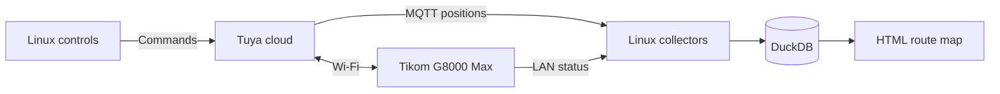
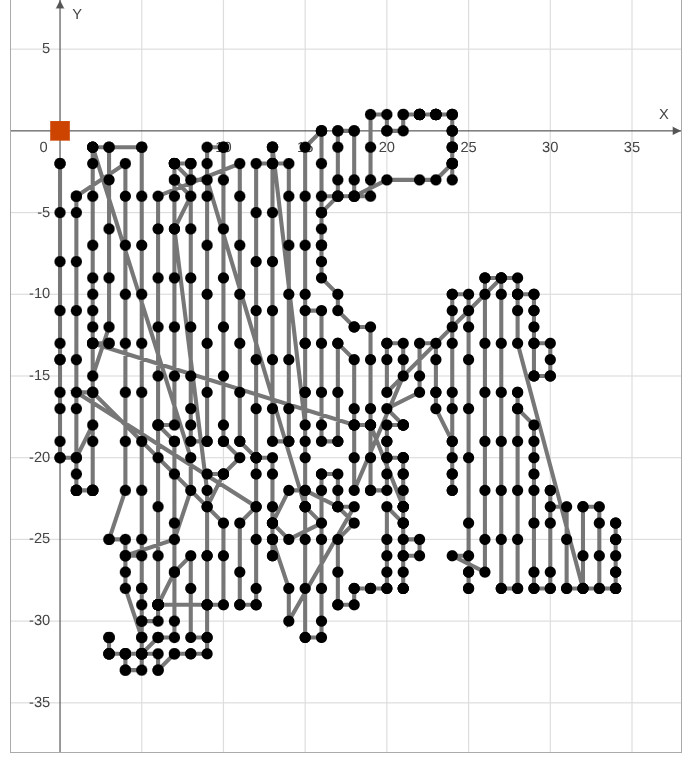

# smart-vacuum

Control a Tikom G8000 Max from Linux, record where it goes, and open the route as an interactive map in your browser.

- **Tikom G8000 Max** is the robot vacuum. Pair it with the Tuya Smart app on 2.4 GHz Wi-Fi. [Tikom setup guide](https://www.tikom.cc/sqnews.asp?id=390)
- **Tuya Cloud** handles start, status, and dock commands. It also delivers the vacuum’s map points over MQTT. [Tuya cloud setup](https://developer.tuya.com/en/docs/iot/Platform_Configuration_smarthome?id=Kamcgamwoevrx)
- **Linux tools** save the points in DuckDB and turn them into an HTML map. A separate collector reads status directly over local Wi-Fi.

## System diagram



## Documentation

- Pair the vacuum, send commands, and read local status. [Control and LAN telemetry](docs/control-and-telemetry.md)
- Replay captures, query points, and interpret gaps in the map. [Route capture and decoding](docs/route-capture.md)
- Find the scripts, test workflow, and data privacy rules. [Contributor guide](AGENTS.md)

## Automatic cleaning run

This **24-minute** cleaning cycle produced **601 position reports** with **zero decode errors**. The vacuum reported that it docked, but the map stream stopped when it began heading home.



The orange square marks the dock at (0, 0). Dots show reported positions in grid units.

## 1. Set up

From the project root on Linux, use Python 3.10 or later. Link the vacuum to a Tuya Smart Home cloud project with access to the device and MQTT service.

```sh
python3 -m venv .venv
. .venv/bin/activate
pip install -r requirements.txt
install -d -m 700 ~/.config/smart-vacuum
(umask 077; touch ~/.config/smart-vacuum/cloud.json)
```

Set your Access ID, Access Secret, device ID, and data center in `~/.config/smart-vacuum/cloud.json`. Use the data center for your linked Tuya project.

```json
{
  "access": "YOUR_ACCESS_ID",
  "secret": "YOUR_ACCESS_SECRET",
  "device_id": "YOUR_DEVICE_ID",
  "region": "western-america"
}
```

## 2. Record a route

### Terminal 1 · Capture

Start the subscriber before starting the vacuum. Wait for its MQTT subscription acknowledgement.

```sh
. .venv/bin/activate
python scripts/gyro_channel.py --seconds 7200
```

### Terminal 2 · Control

Use this terminal to start the vacuum and send it home. Check that the floor is clear before starting.

```sh
. .venv/bin/activate
python scripts/vacuumctl.py status
python scripts/vacuumctl.py start
# To end a bounded test:
python scripts/vacuumctl.py home
```

For a full automatic cycle, let the vacuum return on its own. For a bounded test, use the `home` command above. Verify that status reports `charging` or `charge_done`, then press Ctrl-C in the capture terminal. The recorder saves raw envelopes in `gyro-captures/` and imports the packets and decoded points into `telemetry.duckdb`. The decoder checks framing and CRC32.

## 3. View the route

Query `gyro_positions` in `telemetry.duckdb`.

```sql
SELECT capture_name, record_hex, received_at, x, y, x_from_dock, y_from_dock
FROM gyro_positions
ORDER BY capture_name, source_offset, record_index, point_index;
```

Export one run by substituting its capture filename and hexadecimal record ID from the query.

```sh
python scripts/gyro_plot.py CAPTURE.jsonl RECORD_HEX route-preview.html
xdg-open route-preview.html
```

Coordinates are in grid units, with the reported dock at the origin. A consistent dock location is required for export. Calibrate against a measured floor segment before converting to metres. Lines join successive reports and may span gaps.

## Record status directly over Wi-Fi

```sh
mkdir -p lan-captures
python scripts/lan_capture.py --address VACUUM_LAN_IP --seconds 120 \
  --key-file ~/.config/smart-vacuum/lan.json "lan-captures/run-$(date +%s).jsonl"
python scripts/telemetry_db.py
```

The first run gets a local key from Tuya Cloud. Later runs reuse it. Query `lan_frames` for battery, cleaning status, and other device updates. Route points come from the separate MQTT stream.

## Where I’d like to take this

I’d like owners to be able to send selected events, such as cleaning started or a fault, to an IoT service they manage. AWS IoT Core is one option for connecting those events to a dashboard or automation. Today the collectors save data locally. I’d keep credentials, raw captures, and detailed routes local and let owners choose what to forward. [AWS IoT Core MQTT documentation](https://docs.aws.amazon.com/iot/latest/developerguide/mqtt.html)
