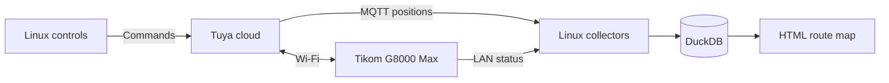

# smart-vacuum

Control a Tikom G8000 Max from Linux, capture its Tuya gyroscope map stream, and explore the reported positions in DuckDB or an interactive HTML plot.

| Task | Tool | Output |
| --- | --- | --- |
| Start cleaning or return to dock | `vacuumctl.py` | Reported vacuum state |
| Record live positions | `gyro_channel.py` | Raw MQTT packets and DuckDB positions |
| View a captured route | `gyro_plot.py` | Standalone HTML map |
| Collect status over local Wi-Fi | `lan_capture.py` | Raw LAN frames and DuckDB telemetry |

## System diagram



## Documentation

- [Route capture and decoding](docs/route-capture.md)
- [Control and LAN telemetry](docs/control-and-telemetry.md)
- [Contributor guide](AGENTS.md)

## Automatic cleaning run

One automatic cycle completed in **24 minutes** and ended with the vacuum reporting `charge_done`. The capture yielded **601 position reports** with **zero decode errors**. The status API reported the return to dock after the MQTT stream stopped delivering positions.


The orange square marks the dock at (0, 0). Dots show reported positions in grid units. [Export an interactive plot](#3-view-the-route) to inspect a local capture.

## 1. Set up

Use Python 3.10 or later on Linux. Link the vacuum to a Tuya Smart Home cloud project and authorize access to the device and device MQTT service.

```sh
python3 -m venv .venv
. .venv/bin/activate
pip install -r requirements.txt
install -d -m 700 ~/.config/smart-vacuum
(umask 077; touch ~/.config/smart-vacuum/cloud.json)
```

Set your Access ID, Access Secret, device ID, and data center in `~/.config/smart-vacuum/cloud.json`. Use the data center for your linked Tuya project.

```json
{
  "access": "YOUR_ACCESS_ID",
  "secret": "YOUR_ACCESS_SECRET",
  "device_id": "YOUR_DEVICE_ID",
  "region": "western-america"
}
```

## 2. Record a route

### Terminal 1 · Capture

Start the subscriber before starting the vacuum. Wait for its MQTT subscription acknowledgement.

```sh
. .venv/bin/activate
python scripts/gyro_channel.py --seconds 7200
```

### Terminal 2 · Control

Use this terminal to start the vacuum and send it home. Check that the floor is clear before starting.

```sh
. .venv/bin/activate
python scripts/vacuumctl.py status
python scripts/vacuumctl.py start
# To end a bounded test:
python scripts/vacuumctl.py home
```

For a full automatic cycle, let the vacuum return on its own. For a bounded test, use the `home` command above. Verify that status reports `charging` or `charge_done`, then press Ctrl-C in the capture terminal. The recorder saves raw envelopes in `gyro-captures/` and imports the packets and decoded points into `telemetry.duckdb`. The decoder checks framing and CRC32.

## 3. View the route

Query `gyro_positions` in `telemetry.duckdb`.

```sql
SELECT capture_name, record_hex, received_at, x, y, x_from_dock, y_from_dock
FROM gyro_positions
ORDER BY capture_name, source_offset, record_index, point_index;
```

Export one run by substituting its capture filename and hexadecimal record ID from the query.

```sh
python scripts/gyro_plot.py CAPTURE.jsonl RECORD_HEX route-preview.html
xdg-open route-preview.html
```

Coordinates are in grid units, with the reported dock at the origin. A consistent dock location is required for export. Calibrate against a measured floor segment before converting to metres. Lines join successive reports and may span gaps.

## Record status directly over Wi-Fi

```sh
mkdir -p lan-captures
python scripts/lan_capture.py --address VACUUM_LAN_IP --seconds 120 \
  --key-file ~/.config/smart-vacuum/lan.json "lan-captures/run-$(date +%s).jsonl"
python scripts/telemetry_db.py
```

The first use gets the local credential from your linked Tuya project. Later sessions reuse the saved credential. The LAN collector polls every three seconds and records pushes between polls in the same capture. The importer stores the results in `lan_frames`. Observed fields include battery, state, cleaning time, area, fault and cleaning-record ID. The gyro route arrived on a separate MQTT topic.

> [!IMPORTANT]
> Keep credentials, raw captures, databases, and generated plots private. Route points can reveal an indoor layout.

## Hardware verification

- **Live route capture** worked on the G8000 Max with Tuya Smart closed after a recent panel session. Availability after a power cycle or long idle period still needs testing.
- **Cloud control** started cleaning and returned the vacuum to its dock. The manual steering trial produced a nearly straight trace, so drawing shapes remains experimental.
- **Local status collection** worked over authenticated Tuya LAN 3.4 with a cached credential. The gyro route uses the separate Tuya MQTT connection.
